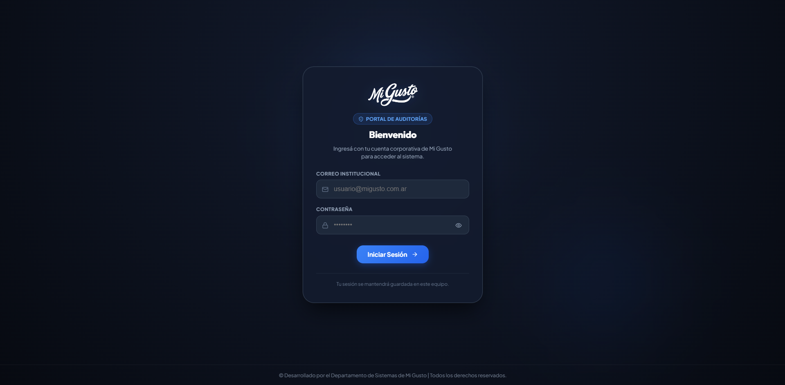
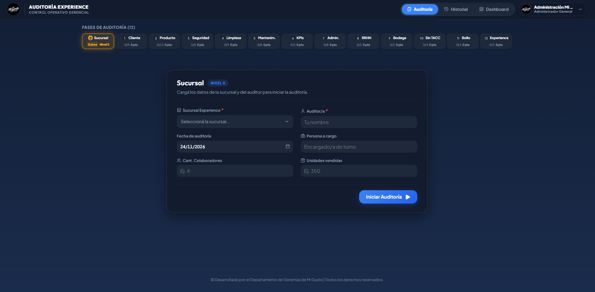
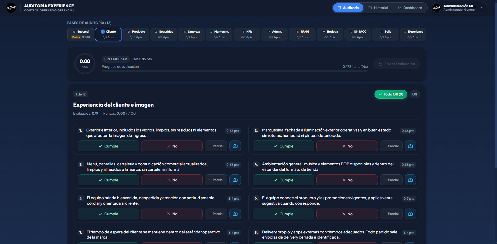
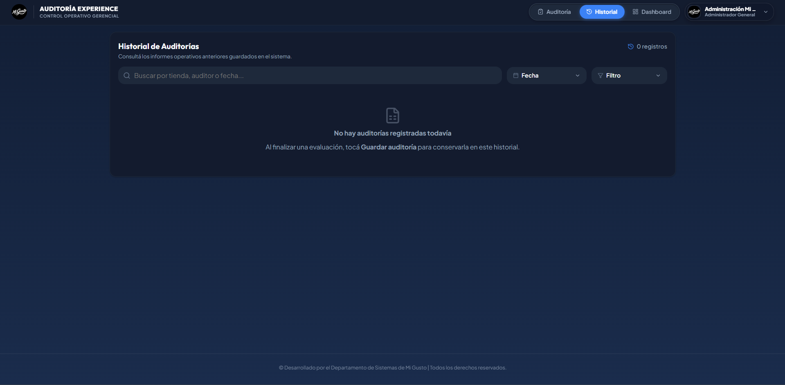
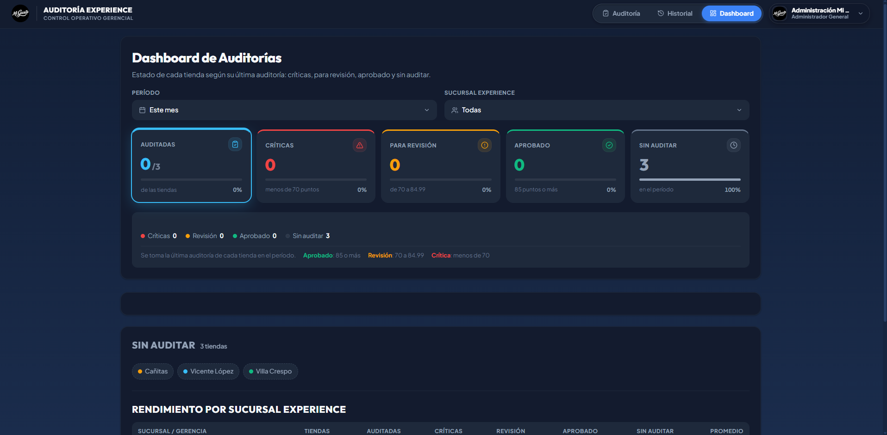
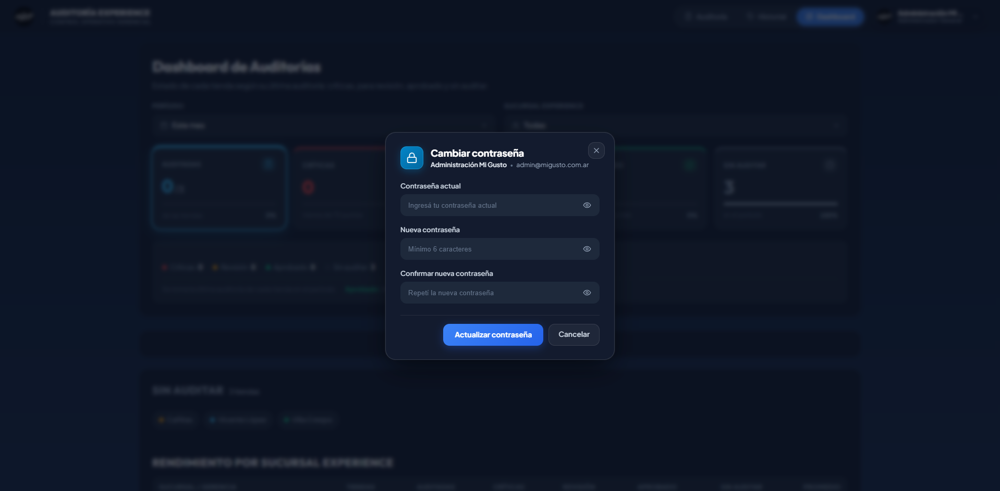

<div align="center">

  

  # Auditoría Mi Gusto Experience · Sistema Gerencial

  <p align="center">
    <strong>Plataforma integral de control operativo, auditoría gerencial y estándares de calidad para la red de sucursales Mi Gusto Experience.</strong>
  </p>

  <p align="center">
    
    
    
    
    
  </p>

</div>

---

## 📸 Galería del Sistema

<table width="100%">
  <tr>
    <td width="50%" align="center">
      
      <br />
      <b>🔐 Acceso Corporativo & Perfiles de Usuario</b>
      <p><i>Ingreso seguro con perfiles restringidos para Administradores y Gerencias Experience.</i></p>
    </td>
    <td width="50%" align="center">
      
      <br />
      <b>🏪 Configuración Inicial de Auditoría (Nivel 0)</b>
      <p><i>Selección exclusiva de sucursal Experience, fecha de relevamiento y datos del auditor.</i></p>
    </td>
  </tr>
  <tr>
    <td width="50%" align="center">
      
      <br />
      <b>📋 Evaluación Operativa en 12 Fases</b>
      <p><i>70 ítems ponderados sobre 100 pts, acciones rápidas "Todo OK", cámara y scoring en vivo.</i></p>
    </td>
    <td width="50%" align="center">
      
      <br />
      <b>🗂️ Historial Centralizado & Filtros Avanzados</b>
      <p><i>Búsqueda instantánea, selector de rango de fechas y trazabilidad sincronizada en la nube.</i></p>
    </td>
  </tr>
  <tr>
    <td width="50%" align="center">
      
      <br />
      <b>📊 Dashboard Ejecutivo & KPIs de Sucursales</b>
      <p><i>Monitoreo gerencial de estados (Aprobado, Revisión, Críticas y Sin Auditar) en la red Experience.</i></p>
    </td>
    <td width="50%" align="center">
      
      <br />
      <b>🔒 Gestión de Seguridad & Claves en Supabase</b>
      <p><i>Actualización de contraseña persistida en base de datos con interfaz ejecutiva sin scroll invasivo.</i></p>
    </td>
  </tr>
</table>

---

## ✨ Características Principales

### 🎯 Formato 100% Exclusivo Experience
- **Alcance Específico de Sucursales**: Diseñado exclusivamente para el formato Experience de la cadena: **Vicente López**, **Cañitas** y **Villa Crespo**.
- **12 Fases Estandarizadas**: Cobertura exhaustiva de las áreas operativas:
  1. *Experiencia del cliente e imagen*
  2. *Calidad de producto*
  3. *Seguridad e higiene*
  4. *Limpieza y orden*
  5. *Mantenimiento e infraestructura*
  6. *KPIs y gestión operativa*
  7. *Administración y caja*
  8. *Recursos Humanos y equipo*
  9. *Bodega y stock*
  10. *Área Sin TACC / Fitzza*
  11. *Pizza en bollo*
  12. *Salón y Servicio Experience*
- **Matriz de Calificación Gerencial**: 70 ítems ponderados sobre un total de **100 puntos**, con umbral de aprobación fijado en **85 puntos**.
- **Regla de Ítems Críticos**: Desaprobación automática ante desvíos críticos graves (ej. vencimientos o seguridad alimentaria).

### ⚡ Flujo de Auditoría Ágil y Confiable
- **Acciones Rápidas ("Todo OK")**: Función para certificar por bloques los segmentos sin desvíos en un solo toque, optimizando los tiempos de auditoría en salón.
- **Adjuntos de Evidencia Fotográfica**: Carga y compresión automática de fotos por ítem almacenadas en Supabase Storage (`experience-audit-photos`).
- **Resiliencia y Sincronización Offline**: Mecanismo de persistencia local preventiva que protege el progreso ante interrupciones de conectividad en tienda.

### 📊 Dashboard e Historial Inteligente
- **Métricas Ejecutivas en Tiempo Real**: Visualización de tiendas auditadas, promedios de calificación y segmentación de estado (Aprobado, Para Revisión, Crítica, Sin Auditar).
- **Filtro de Rango de Fechas Integrado**: Selector responsivo de períodos temporales sin solapamientos ni desbordes en dispositivos móviles.
- **Roles y Permisos Rigurosos**:
  - **Administradores General**: Control total sobre el sistema, edición, auditorías y eliminación de registros históricos.
  - **Gerencias Experience**: Carga de auditorías, consulta de historial propio, exportación y visualización del panel general.

### 🎨 Experiencia Visual & Diseño Ejecutivo
- **Paleta Slate Mate**: Diseñado con contrastes confortables (`#162540`, `#131b2e`), acentos azul eléctrico (`#3b82f6` / `#0284c7`), verde esmeralda funcional (`#10b981`) y rojo coral (`#ef4444`).
- **Micro-interacciones Fluidas**: Transiciones suaves impulsadas por **GSAP**.
- **Responsive Mobile-First**: Optimizado minuciosamente para smartphones y tablets en campo, garantizando campos de una sola línea y popups adaptativos.

---

## 🚀 Instalación y Puesta en Marcha

### Prerrequisitos
- **Node.js** (v18.0 o superior)
- **pnpm** (recomendado para este proyecto) o npm

### 1. Clonar el repositorio
```bash
git clone https://github.com/tu-usuario/MG-ProcesoGerencial.git
cd MG-ProcesoGerencial
```

### 2. Instalar dependencias
```bash
pnpm install
```

### 3. Configuración de Variables de Entorno
Crea un archivo `.env` en la raíz del proyecto con las credenciales de tu proyecto de Supabase:

```env
VITE_SUPABASE_URL=https://tu-proyecto.supabase.co
VITE_SUPABASE_ANON_KEY=tu-anon-key-aqui
VITE_SUPABASE_BUCKET=experience-audit-photos
```

> [!NOTE]
> Para inicializar las tablas, políticas de seguridad RLS y buckets de almacenamiento, ejecuta el script [`supabase_schema.sql`](supabase_schema.sql) en el **SQL Editor** de tu consola de Supabase.

### 4. Iniciar en modo desarrollo
```bash
pnpm run dev
```
La aplicación quedará disponible en `http://localhost:3000` (o el puerto configurado por Vite).

### 5. Compilar para producción
```bash
pnpm run build
```
Para previsualizar localmente la versión compilada:
```bash
pnpm run preview
```

---

<div align="center">
  <sub>Desarrollado para el Departamento de Operaciones y Calidad de <strong>Mi Gusto Experience</strong>.</sub>
</div>
